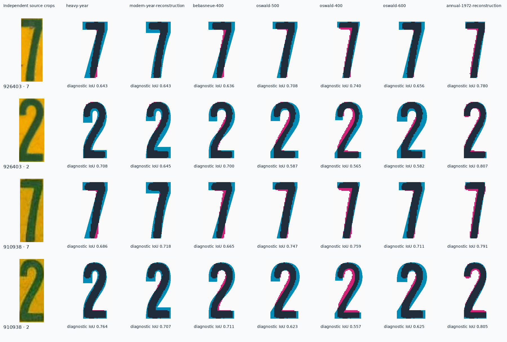
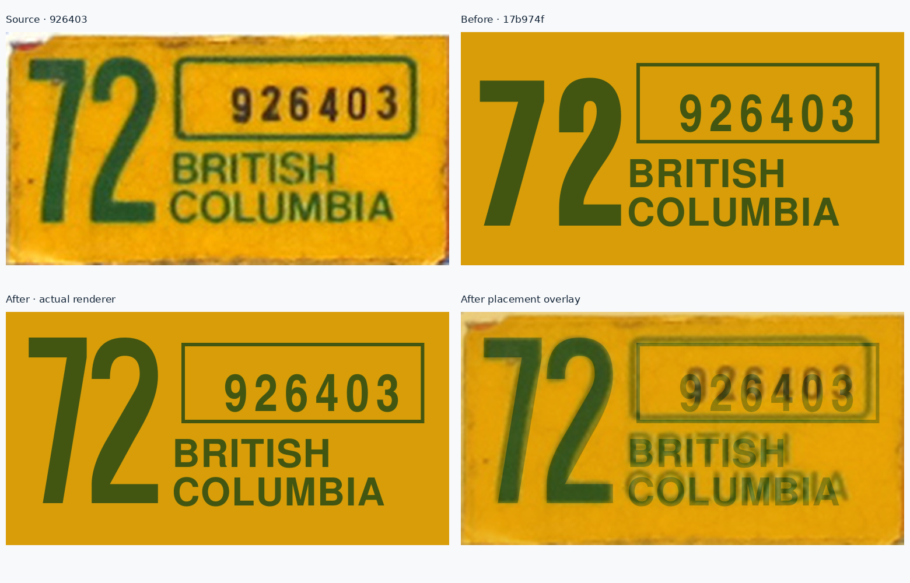

# 1972 annual decal: narrow year numerals

The 1972 `72` was approximately 23.5% too broad when compared at equal painted
height. Its `maxWidth` then reduced the entire heavy run, making it shorter while
leaving the underlying width/height mismatch. This correction gives the two
observed numerals their own native construction and enough room to render at the
requested cap height.

Only the 1972 year role changes. The control, province lines, palette and other
annual decal years are outside this correction.

## Source evidence

Two independently photographed specimens support the same narrow forms:

| Control | Source | Retained crop | Numeral evidence |
| --- | --- | --- | --- |
| 926403 | [BCpl8s photograph](https://www.bcpl8s.ca/images/Decals/Passenger/1972-926403.jpg) | 190 × 100 px | Primary placement reference; both numerals have 71 px painted height at the default threshold |
| 910938 | [BCpl8s catalogue photograph](https://www.bcpl8s.ca/images/Decals/Passenger/1972.jpg) | 178 × 98 px | Corroborating shape reference; numerals have 65–67 px painted height |

[references.json](references.json) records exact crop regions and SHA-256 hashes.
The original crops remain in `public/bc-decal-corrections/annual-1972/`. Their
original perspective and pixel sampling are retained. The year is separated into
two independent green-paint connected components at each of four tested colour
thresholds. No artificial equal-width partition is used for these new comparisons.

## Native candidate comparison and construction

The review compares 60 named profiles: existing supplied/open native candidates,
documented native width-axis candidates, the older compressed construction, the
new modern-year construction, and this 1972 construction. Some existing named
profiles share identical outlines; these are candidate profiles, not 60 distinct
historical typefaces.



The existing `heavy-year` has a broad 7 head and heavy 2 shoulder. The modern-year
candidate also remains too broad/heavy and has different 7/2 details. Several
Oswald candidates improve the 7, but their 2 is much wider than the photographed
numeral. A shared printing process between 1972 and modern years is neither
assumed nor claimed.

`src/templates/dies/decal-annual-1972.ts` provides only `7` and `2`:

- **7:** 35-unit horizontal head, 12-unit bar, shallow straight diagonal and
  12-unit stem. Advance 38. The geometry is authored directly at cap height 100.
- **2:** 40-unit round shoulder with an open counter, long diagonal, and
  11.5-unit foot. Advance 43. The shoulder uses smooth cubic curves.

These are clean geometric reconstructions supported by both photographs. They
do not trace scan edges or horizontally compress a font. Fine contour and exact
font attribution remain uncertain. The profile has no fallback for unobserved
numerals and cannot be substituted wholesale for another decal printing family.

The mean diagnostic intersection-over-union across both numerals, both sources
and four thresholds is `.804` for the construction, `.680` for the old
`heavy-year`, and `.656` for the modern-year candidate. Scores describe these
paint masks, not the probability of historical font identity.

## Placement and before/after result



The frozen before renderer is `17b974f51c687780c5d0b106fd9ae37e4c83ccae`.
The year run becomes:

```json
{
  "x": 0.203,
  "baseline": 0.82,
  "cap": 0.71,
  "width": 0.33,
  "profile": "annual-1972-reconstruction",
  "tracking": 0
}
```

On the 190 × 100 decal plane, the year now fits naturally at its 71-unit cap
height. Its authored ink extent is approximately `x=9.815–65.195, y=11–82`;
the primary photograph's segmented paint occupies `x=10–65, y=11–82`.
The maximum width is retained as a guard rather than used to squeeze the shape.

| Year comparison | Painted width / height | Uniform-height diagnostic IoU |
| --- | ---: | ---: |
| Primary source | .7746 | — |
| Before | .9567 | .436 |
| After | .7817 | .776 |

The remaining approximately 0.9% width difference is below one source pixel at
the photographed size. The 2's shoulder, diagonal and foot are also compared
individually; matching the total run width alone is not treated as sufficient.

Shape overlays use magenta source paint, cyan model ink, and dark overlap. They
match height and centre with one uniform scale. Placement overlays preserve the
source-plane position. There is no independent x fitting, per-letter stretching,
perspective correction, or promoted bitmap trace.

## Reproduce and verify

Run from the repository root:

```sh
python scripts/review-decal-annual-1972.py
```

The review uses Vite SSR with dependency scanning disabled to call the actual
renderer. Inkscape rasterizes the real paths. Python dependencies are Pillow,
numpy and scipy; no application runtime dependency or font binary is introduced.

Checks require the corrected profile, the literal `72` glyph sequence, natural
run fit, ink inside the decal, observed width proportions, portable vector output,
and unchanged explicit control `926403`. [validation.json](validation.json)
records the current run, every candidate/occurrence/threshold score, and check
results. Final evidence is generated without `--candidate`; that optional flag
exists only to evaluate the documented proposal in memory before integration.

This is a focused Inkscape review. It does not replace the consolidated browser,
all-month or export checks, and does not claim that the province/control or every
1972 printing detail has been reconstructed exactly.
