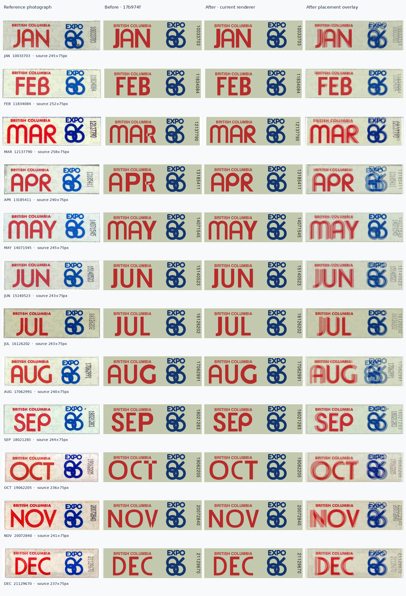
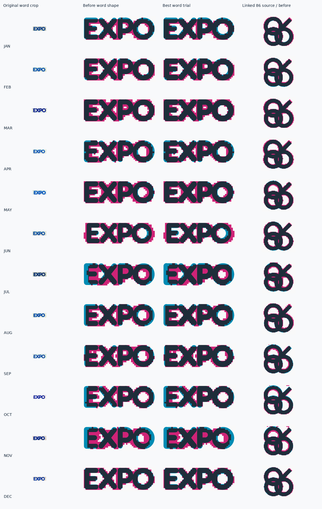

# 1986 renewal decal: rounded months and EXPO artwork review

This correction is scoped to the 1986 passenger renewal decal. Its month letters
are separate from the six supplied Frankfurter outlines used on the EXPO souvenir
plate. The supplied EXPO logo primitives and the souvenir/booster artwork remain
unchanged.

The frozen before renderer is `17b974f51c687780c5d0b106fd9ae37e4c83ccae`.
All twelve source crops and their photographed controls are recorded in
[references.json](references.json). Source credit: [BCpl8s passenger decal
gallery](https://www.bcpl8s.ca/Decals-Gallery.html). The retained crops are 75 pixels
high; enlarging them makes the evidence easier to inspect but adds no information.

## Implemented corrections

`src/templates/dies/decal-expo-month.ts` adds the decal-only
`bc-decal-print-1986-rounded-corrected` profile. It contains only the 19 observed
month capitals. Unsupported letters do not fall back to invented forms.

| Letter | Before | Derived correction | Supporting occurrences |
| --- | --- | --- | --- |
| P | A straight-sided, heavy Nimbus bowl | Smooth round bowl, 72-unit outside width, 38.4-unit round counter and 16.5-unit stem; advance 82 | APR and SEP |
| R | A Roboto candidate with a squared shoulder and transparent rectangular join | Smooth 63-unit round bowl, smaller 30-unit counter, 16.5-unit stem and diagonal leg; total ink width 67, advance 77 | MAR and APR |
| T | An overlapping cap and stem in one even-odd path | The original two additive contours painted separately; original coordinates and advance retained | OCT; the source glyph crop is partly merged and remains tentative |
| V | Overlapping strokes knocked out the foot | The original two additive contours painted separately; original coordinates and advance retained | NOV |

The notch was a real SVG fill defect. The die renderer uses `fill-rule="evenodd"`
for filled glyphs. Some imported font paths contain overlapping additive contours;
combining them in one even-odd path removes their intersection. T/V now retain those
same contours as separate painted paths. R's new continuous outer contour and round
counter avoid both the overlap defect and the visibly squared bowl.

P/R are authored geometric constructions, not traces of the scan's pixel boundary.
Their round counters, bowl proportions and stems were compared independently in
two photographs per character. The first thin-stem candidate did not improve R;
the retained 16.5-unit stem and smaller R counter fit both occurrences. The existing
M/A constructions and all other observed candidate outlines remain unchanged.

The typography record selects the new profile, changes `AR` kerning from `-7.2`
to `0`, and adds `PR: -3`. These adjustments account for the new construction's
bearings. Other pairs, cap height, position and maximum run width are retained.
No glyph receives an independent horizontal scale. Whole-run fitting continues
to use the existing uniform scaling rule.

## Before/after evidence



Each month folder under `public/bc-decal-corrections/expo86/` contains the source
crop, frozen before SVG, current SVG, both PNGs, before/after placement overlays,
and before/after month shape overlays. Separate occurrence boards retain the
original P/R/T/V crop beside both shape comparisons:

- `1986/R-shape.png` — MAR R.
- `1986-apr/P-shape.png` and `1986-apr/R-shape.png` — APR P/R.
- `1986-sep/P-shape.png` — SEP P.
- `1986-oct/T-shape.png` — OCT T, tentative segmentation.
- `1986-nov/V-shape.png` — NOV V.

Shape overlays use magenta for source paint, cyan for model ink, and dark overlap.
They match ink height and horizontal centre with one uniform scale. Placement
overlays retain the source-plane position after centring the complete decal at
equal height. Neither view applies perspective rectification or independent
width fitting. Different scan aspect ratios remain visible.

The default threshold diagnostic gives MAR R `.745 → .862`, APR R
`.740 → .859`, APR P `.727 → .903`, and SEP P `.718 → .924` intersection-over-union.
These are relative mask comparisons, not probabilities of historical identity or
proof that every contour is exact. T's ambiguous source partition is excluded from
reliable shape scoring. The original photographs and full-month views take
precedence over a score.

## EXPO word and linked 86: retained after separate comparison

The earlier visual impression that the word/symbol ratio needed alteration was
not supported by the component review. The word and linked symbol were measured
separately across all twelve photographs. Their source proportions vary with
pixel rounding and scan registration. The supplied word/symbol width ratio is
`.905`, inside the photographed `.875–.918` range. Its height ratio is `.285`,
inside the photographed `.271–.313` range. Altering the component scale would trade one photograph's placement for
another without establishing a better reusable master.

The review also tests word and symbol print weight independently, leaving all
primitive centrelines and the component layout untouched. Thinner EXPO word trials
perform worse than the supplied word. Heavier word and linked-86 trials can
improve low-resolution paint-mask comparisons, especially around overlapping
ring counters. The improvement continues toward the heavier edge of the tested
range instead of identifying a stable master weight. These scans do not separate photographic blur and print spread
from an intentional master stroke change. That weight-only candidate is retained
as diagnostic evidence; it is not promoted to production geometry.



`validation.json` records every word/symbol trial, each source/threshold score and
the independently measured component ratios. The original `expo86-logo.json`,
`expo86-logo.ts`, and `frankfurter-expo.ts/.json` have no change from the before
revision. This preserves the supplied masters and their separate souvenir/booster
uses. There is no replacement decal logo function or hidden change to those uses.

## Reproduction and validation

Run from the repository root:

```sh
python scripts/review-decal-expo86.py
```

The script calls `scripts/render-decal-expo86.mjs` to load the actual renderer
through Vite SSR with dependency scanning disabled. It asserts that every explicit
control survives unchanged and all twelve renderings select the corrected profile.
Inkscape rasterizes the actual path-only SVGs; before and after full decals use the
same 400-pixel output height. The diagnostic masks never become production paths.
Python dependencies are Pillow, numpy and scipy; no new runtime application or
font dependency is introduced.

The raster checks sample the formerly transparent R/T/V intersections and verify
that they are opaque after correction, while the P/R counters remain open. The
before fixtures must show the missing ink in the same sample regions. This is a
rendered regression check, independent of how the path fix is implemented.

`--candidate` is an explicit development mode that applies the documented profile
and kerning proposal in memory. Final evidence is generated without that flag;
`validation.json` records `candidateTypography: false`. No browser validation or
the earlier repository-wide 572-combination result is implied by this focused
Inkscape review. Broader application and export checks belong to the consolidated
correction report.

The remaining month candidates, province/control lettering, scan-dependent
placement, palette, and exact historical font identification remain approximations.
The correction establishes supported reusable P/R shapes and intact T/V joins;
it does not certify every month outline or the original printing tooling.
