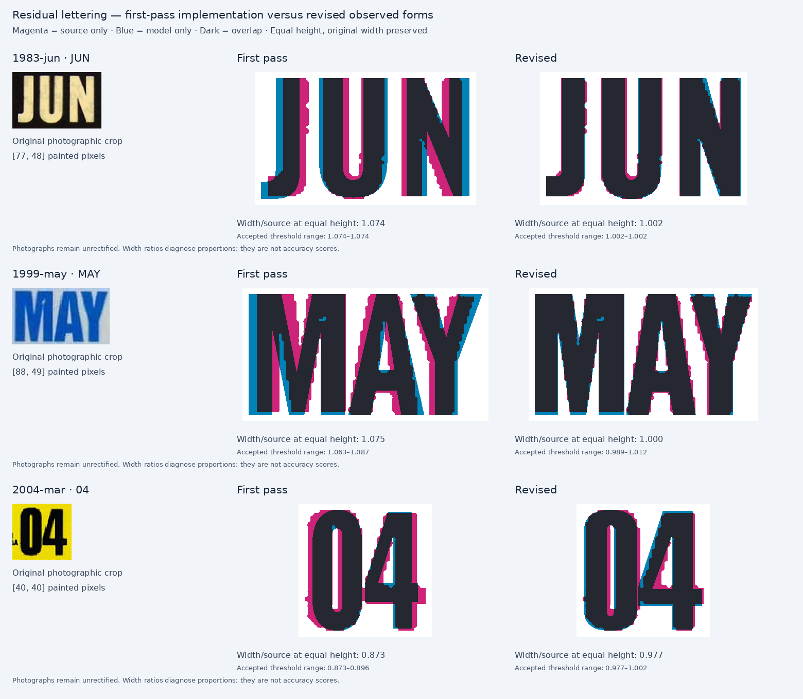

# BC decals: second overlay and implementation pass

Reviewed 7 November 2026. This pass starts from the completed first-pass commit
`24689246670c25f91e0d1676a0647f053dbca68e`.

**Thirty-eight catalogue variants receive further changes. Twenty-three of the
28 previously retained references now have bounded corrections.** All 68
canonical references remain in the review, including cases that still need
better evidence. A corrected width or a passing geometry check does not mean a
decal is historically exact.

The [interactive gallery](../../../public/bc-decal-residuals/index.html) contains
the original source, complete first-pass baseline, current render, opacity
overlay, exact inputs and per-role painted bounds. The [case ledger](case-ledger.csv)
records this pass's action and remaining limitation separately from the
first-pass status. The [method walkthrough](METHOD.md) explains how font,
spacing, width, cap height and placement are tested independently.

## The seven requested residuals

| Requested issue | Result of this pass | What remains |
| --- | --- | --- |
| Thick-border 1999 MAY about 7.6% broad | Separate 1999 M/A/Y contours and advances, supported by independent M/A observations; primary equal-height width ratio improves from 1.075 to 1.000. | Y still has one small source. Threshold variation gives about 0.989–1.012; fine contours are not exact. |
| 1983 JUN proportions after its margin correction | Limited J/U/N construction, corroborated by JUL and JAN; ratio improves from 1.074 to 1.002, while retaining positive left clearance. | Small unrectified photos limit fine edges and weight. The faint control remains tentative and excluded from glyph scoring. |
| 2004 year width and tiny province lettering | Broader fixed `04`, corroborated across six months; MAR placement and the shared year clearance are handled separately. Rounded substrate corrected. | Primary `04` is still about 2.3% narrow. Tiny province segmentation is rejected; its contours are retained. |
| Weak modern `3/4/6/8/9` evidence | Occurrence audit distinguishes early and later printing. Retain corroborated early 4/6/8; use separate later 0/1/2/3/9 contours/advances for 2019–2023. | 3 has only one small occurrence; 9 lacks an enlarged source. A separate later 2018 group remains unmodeled. |
| Small province lettering | New limited wide capitals for 1981–1982 and tall capitals for 2010–2013; heavier native candidate for 1985, 1987 and 2006; selected stack placements corrected. | Other tiny legends remain approximate. Larger sources improve the evidence but do not identify an original font. |
| Older and 2018–2022 specimen placement | Annual control boxes/print, selected older controls, modern columns/footer and exact-month dates are corrected independently. Additional JAN spacing and JUL native-font improvements are integrated. | Other months retain their prior registration unless independently supported. Fine control/month contours remain visible in the ledger. |
| Colour, physical edges and historical font identity | Corrected visible round/square substrate distinctions; measured photographic colour variation and checked ICBC documents. | No calibrated palette, exact cutting specification, surface/security-layer model or historical typeface identity is established. |

## 1. Letter shapes, widths and pair spacing

The following are ratios of **painted width at equal painted height**. Source
and model are scaled uniformly and horizontally centred. Their widths are not
forced to coincide. A ratio of one is an extent match, not an accuracy score.

| Observed run | First-pass width/source | Revised width/source | Scope |
| --- | ---: | ---: | --- |
| 1983 JUN | 1.074 | 1.002 | JUN only |
| Thick-border 1999 MAY | 1.075 | 1.000 | MAY only; 1998 Type II keeps its own master |
| 2004 MAR `04` | 0.873 | 0.977 | Fixed year shape across 2004; separate MAR geometry |
| 2018 JAN | 0.922 | 0.949 | Existing contours; observed AN gap |
| 2019 JAN | 0.870 | 0.955 | Existing contours; observed JA/AN gaps |
| 2020 JAN | 0.902 | 0.979 | Existing contours; observed JA/AN gaps |
| 2021 JUL | 0.770 | 0.957 | Native Anton with observed JU/UL gaps |



The 1999 change is supported beyond a whole-word width. The larger JAN source
corroborates A; a separate MAR corroborates M/A. The M's shallower central notch
and the narrower A are authored separately from the 1998 construction. The
alternate crop of the same MAY specimen remains a duplicate, not another
independent observation. The revised valid threshold range is approximately
0.989–1.012. Its exact-looking central ratio should not conceal the small-source
uncertainty, especially for Y.

For 1983, the prior U was broad, and the J hook and N diagonal differed. The
limited new profile contains only J/U/N. It is not substituted into unobserved
month words. For 2004, six photographs support the broader year: their revised
run ratios are 0.977–1.002, versus 0.873–0.896 before. Some thresholds join the
two source digits, so the analysis withholds per-digit scores and compares the
stable whole year instead.

The JAN/JUL follow-up shows why a width error is not automatically a font
replacement. Native Anton improves JUL's J/U substantially. Its short L foot
and slightly high J hook remain documented. In JAN, Anton worsens the A counter
and makes J too broad in two references. The existing JAN contours are retained;
only the independently observed pair gaps and uniform paint-height/centre
registration change. A still runs narrow, and N remains broad in 2019/2020.

The [lettering report](lettering/README.md), [JUL comparison](lettering/modern-jul-review/README.md)
and [JAN comparison](lettering/modern-jul-review/jan-review/README.md) preserve
raw crops, native candidates, every accepted occurrence, sensitivity checks and
the exact production proposals. None of the new constructions uses an
independent horizontal squeeze of an existing font.

## 2. Modern numeral groups and confidence

The supplemental modern review contains 60 downloaded originals: 57 small
catalogue photographs and three independent enlarged Commons photographs.
Seven catalogue files duplicate canonical references, leaving 53 additional
photographs relative to that set. Repeated glyphs are observations within a
photograph, not extra specimens. All source inputs, hash checks, inclusions,
exclusions and printing groups are in the [modern source ledger](modern/source-ledger.csv).

The later profile provides only `0/1/2/3/9`. Its wider 0, narrower 1 and separate
9 construction are distinct from the early profile. The 2 keeps its contour
but receives the later observed advance. These changes address both glyph
shape and the distance between successive glyph starts.

| Photographed year | Previous width/source | Later profile width/source |
| --- | ---: | ---: |
| 2019 JAN | 0.921 | 1.001 |
| 2020 JAN, control 20726786 | 0.887 | 1.007 |
| 2021 JUL | 0.908 | 0.998 |
| 2022 MAR | 0.898 | 0.999 |
| 2023 MAR | 0.893 | 1.008 |

Across 26 later catalogue photographs, the whole-year range improves from
0.867–0.952 to 0.984–1.045. These sources informed the construction; this is not
a held-out accuracy test. Enlarged independent examples support the direction
of the 0/1 changes while retaining perspective and print-spread uncertainty.

| Previously weak digit | New evidence and decision |
| --- | --- |
| 3 | One 46-pixel-high 2023 occurrence. Coarse contour/width improved; fine detail remains low confidence. |
| 4 | Nine 2014 photographs, about 53–56 pixels high. Retain the early contour; no enlarged year 4 obtained. |
| 6 | Eleven 2016 photographs, about 56–60 pixels high. Retain the early contour; fine details remain limited. |
| 8 | Five early 2018 examples corroborate retention. Six later 2018 examples show a different group; no unsupported expiry-month boundary is introduced. |
| 9 | Eleven 2019 photographs, about 42–46 pixels high. Use the separately authored later form; no enlarged year 9 obtained. |

Modern control digits remain a separate profile. The three enlarged originals
add 24 control occurrences, including previously weak 2 and 4 evidence. Their
native-derived contours are retained. The corrected visible inputs are APR
2020 / **23747480**, APR 2021 / **33502027**, and FEB 2022 / **71708687**.

The [modern report](modern/README.md) distinguishes incorrect source filenames
or captions from two preliminary audit transcription errors. Both audit errors
are logged, and their affected occurrence comparisons were regenerated. Exact
controls are checked against the visible photographs; filenames never replace
that step. The canonical all-zero 2020 JAN example remains qualified layout
evidence and does not establish ordinary issuance.

## 3. Province lettering and the 28 previously retained references

The enlarged sources support two limited twelve-capital constructions for the
fixed BRITISH/COLUMBIA words. They do not establish complete historical
alphabets.

The wide 1981–1982 words improve substantially over the narrow previous
candidate. In the larger 1981 comparison, the prior width/source ratios are
about 0.673 and 0.697; the revised words are about 0.997 and 0.994. Fine edge and
weight precision remains limited by the photographed print.

The taller 2010–2013 construction corrects the generic candidate's rounded
rectangle bowls and proportions. Against the enlarged 2012 source, BRITISH
and COLUMBIA improve from approximately 14.2%/14.1% broad to 2.4%/6.1% broad at
equal whole-line painted height. The source's slight line tilt affects that
bounding height; the remaining ratio is not treated as isolated glyph-width
error or eliminated by squeezing the letters.

Existing native Archivo 900 at its width-axis value 75 better matches the
heavier province printing in 1985, 1987 and 2006. It is labelled as a visual
candidate. Tiny 2004–2007 province masks that touch neighbouring ink or an
inspection boundary are rejected. The 2006 choice relies on its larger APR
source, with a separate family clearance constraint for the assembled layout.

Every previously retained reference has an individual decision in the
[28-case review](province-placement/retained-case-decisions.csv). The root
ledger additionally includes substrate changes from this pass:

| Earlier retained group | This pass |
| --- | --- |
| 1971, 1974, 1975, 1976 | Correct annual control size/spacing and panel geometry; 1975 also receives a coherent province/year composition. |
| 1980 | Move the independently measured control panel only. The rejected control mask does not drive a text translation. |
| 1981, 1982, 1985, 1987, 1988 | Improve the supported province profile, size or stack placement; retain limits for other printed roles. |
| 1989, 1990, 1991, 1992, 1993, 1995, 1996 | Translate only the photographed control selection; preserve native control shapes and other months. |
| 2005, 2007 | Correct rounded substrate silhouettes; retain the uncertain tiny province/control candidates. |
| 2006, 2009, 2010, 2012 | Apply supported province changes and selected composition/barcode corrections, plus substrate treatment. |
| 1978, 1994, 1996-pink, 1997, 1998 | Retain after review. Their remaining role-specific differences and required evidence stay explicit. |

Thus **23 of the 28** now receive a correction, and **five remain unchanged**.
The remaining 30 unchanged renders in the full 68-case gallery also include
first-pass corrections that were deliberately retained, such as EXPO artwork
and the double-outline family. "Unchanged in this pass" does not mean
"unreviewed" or "historically exact."

The 1991 evidence demonstrates why specimen scope matters. Its larger JAN
example places the control much higher than the pinned JUN example. The JUN
translation is therefore confined to JUN. The independent 1990 JAN example
corroborates a low control baseline, but still does not establish identical
registration for every month and serial.

## 4. Colour, substrate edges and font identity

The visible silhouettes support rounded 2004–2009 substrates and square
2010–2016 substrates. The renderer now respects the audited corner-radius
setting in its earlier solid branches. The chosen clean radii remain
approximations: 0.08 times height for 2004 and 0.10 for 2005–2009. Damaged 2006
and tightly cropped 2008 edges have lower confidence.

The January–June 2017 square layout and July-onward rounded layout are retained.
ICBC's [Bulletin 14](https://www.partners.icbc.com/assets/3mOlwuSlJiQqbPjb7gfnBi/bulletin-14-leap-year-2016-insurance-decal-changes.pdf),
dated 3 February 2016, describes rounded corners, a slight colour change and
reduced font size beginning with July 2017 expiry decals. It provides no
measured radius, cutting tolerance, colour standard or decal typeface name.

The [material report](material/README.md) shows explicitly located substrate
colour patches, their decoded RGB medians and variation. The existing palette
is retained because no calibrated target or controlled capture conditions
accompany the photographs. A digital mismatch is visible; an exact physical
replacement colour is not established. ICBC's
[Bulletin 17](https://www.partners.icbc.com/assets/4R45ykMZi3RDDG0z2BP6mA/bulletin-17-decal-replacements.pdf)
also documents fading affecting dates, controls and barcodes, so pale or broken
old ink is not automatically a printing-master feature.

Useful next evidence is specific: an intact measured sample or cutting drawing
for dimensions/radii; controlled colour measurements or production colour
specifications; multiple lighting angles for surface/security-layer behaviour;
and original artwork/font records for a historical typeface identification.

## 5. Integration and verification

The full family check was necessary. The broader 2004 year fitted MAR but
collided with COLUMBIA in the other eleven selections. Its base anchor now
moves 4.29 units at a 100-unit decal height, leaving 2.907 units of actual paint
clearance; MAR remains unchanged. The heavier 2006 province candidate touched
MAR/MAY, so a separate 2.5-unit province translation restores clearance without
shrinking the letters or relying on the rejected tiny MAY masks.

The initial thirteen failing fixtures and their remedies are preserved in
[integration-corrections.json](integration-corrections.json). The final full
rerun passes **all 572 catalogue/month combinations across 55 variants** with
zero paint-bound, collision, glyph-substitution or checked panel-containment
failures. These are functional geometry checks, not photographic-accuracy
scores.

The production application preflight also passes all **68 exact reference
selections plus one leading-zero control case**, using offered catalogue
options, validation and actual printed vector glyph sequences. New province
and later-year contours pass **29 actual raster glyph topology checks at
three thresholds**. The separate focused lettering checks preserve open
counters, connected ink and natural fitting.

The final nine family contact sheets have all been visually inspected. The
gallery contains **38 changed raster pairs and 30 unchanged pairs**, matching
the semantic case ledger. All eight focused report figures are readable.

| Completed check | Result |
| --- | --- |
| Complete application suite, three disjoint bounded runs | 1,969 tests pass across 71 unique files; no sample-count reduction |
| Focused input, segmentation and overlay checks | 33 tests pass |
| Production TypeScript/build | Pass; existing large-chunk warning retained |
| Actual-ink family checks | 572 fixtures, 55 variants, zero failures |
| Offered application selections and printed glyphs | 68 references plus one leading-zero case pass |
| New profile raster topology | 29 glyphs at three thresholds pass |
| Final visual review | All 68 references across nine sheets inspected |
| Offline package integrity | 340 embedded source/render/SVG assets and eight focused figures match their source bytes |

The [standalone package check](standalone-verification.json) also verifies exact
month/control strings, preserved first-pass ledger history, six embedded
supporting downloads and JavaScript syntax. These are static packaging checks;
they do not substitute for interactive browser execution.

Complete application tests, build status, source/capture hashes and exact
command outcomes are recorded in [validation.json](validation.json). Browser
interaction/export checks are prepared for Chromium, Firefox and WebKit, with
all 68 application reference cases and the extra leading-zero case. They are
**not reported as executed here**: local Chromium's singleton socket is blocked
by the environment. A broad Python discovery invocation encountered that
known browser setup failure; the separate non-browser audit suites pass.

The earlier automatic approval review rejected publishing the branch and its
generated evidence assets to GitHub without explicit publication authorization.
The work remains local; no push, pull request, deployment or browser/export
success is claimed. The prepared workflow can be run when publication is
authorized, or the checks can be run in a normal local development environment.

## Reproduce the final gallery and application checks

Use the complete clean first-pass checkout as the baseline. Its source must
not be replaced by a copied typography JSON or an incomplete renderer.

```sh
python3 scripts/build-decal-online-analysis.py /tmp/plateforge-bc-pass2 \
  --cached-crops --baseline-root ../plateforge-decal-pass1 --render-only
python3 docs/research/bc-decal-residuals/build-ledger.py
python3 scripts/build-decal-correction-overlays.py \
  --render-json /tmp/plateforge-bc-pass2/render-data.json \
  --output public/bc-decal-residuals \
  --dispositions-json docs/research/bc-decal-residuals/case-dispositions.json
node scripts/render-decal-typography-fixtures.mjs /tmp/bc-decal-fixtures.json
python3 scripts/verify-decal-ink-bounds.py \
  --fixtures /tmp/bc-decal-fixtures.json \
  --output docs/research/bc-decal-residuals/family-ink-verification.json
node scripts/verify-decal-application-selections.mjs \
  docs/research/bc-decal-residuals/application-selections.json
BASE_PATH=/plateforge/ npm run build
```

The capture validates the 68 pinned cached crop hashes. It does not claim to
redownload and reverify all canonical original image bytes. Supplemental
originals have their own hash inventories. Source photographs retain their
per-source credits and licences; see the separate lettering, modern and
province manifests rather than assuming one licence for all images.
