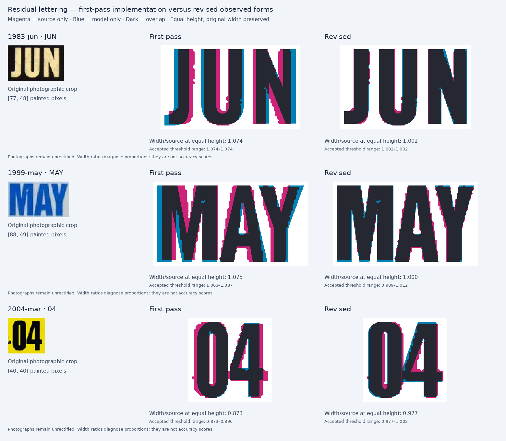
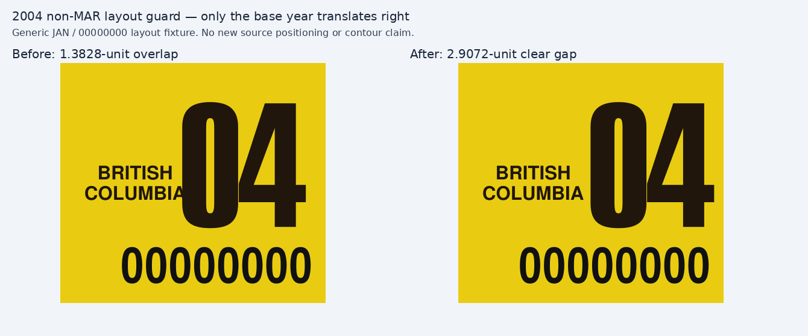

# Residual lettering: 1983 JUN, thick-border 1999 MAY, and 2004 `04`

Second-pass review, 7 November 2026. The comparison starts with the completed first-pass implementation at `24689246670c25f91e0d1676a0647f053dbca68e`, rather than the earlier uncorrected main branch. These changes address specific painted proportions, counters, joins and pair spacing. They do not identify a historical typeface or certify exact production tooling.

## What changed

| Observed run | First-pass width / source | Revised width / source | Scope |
| --- | ---: | ---: | --- |
| 1983 JUN | 1.074 | 1.002 | J/U/N construction and placement for JUN only |
| Thick-border 1999 MAY | 1.075 | 1.000 | Separate 1999 M/A/Y master, exact MAY only; 1998 Type II retains its own master |
| 2004 MAR `04` | 0.873 | 0.977 | Fixed `04` construction; photographed MAR placement, plus a minimal non-MAR collision accommodation |

These are **equal painted-height width ratios**, not accuracy scores. The source width is preserved. Source and model are scaled uniformly to the same painted height and placed on the same horizontal centre. The raw photographic crops remain beside the derived masks.



The small images do not warrant three-decimal claims of physical precision. Changing the luminance threshold by ±12 levels leaves the 1983 JUN extent unchanged, puts revised 1999 MAY between **0.989 and 1.012**, and puts revised 2004 MAR between **0.977 and 1.002**. The alternate crop of the same 1999 MAY gives 0.996; it is **not an independent specimen**. Across six 2004 month photographs, the revised ratio is **0.977–1.002**, versus **0.873–0.896** for the first-pass profile. The broader `04` is supported by repeated photographs rather than a single exact-looking fit.

## 1983: keep the margin, correct the letters

The native Oswald 600 candidate's U is too wide for the photographed JUN. Its N diagonal and J terminal also differ. A complete-run width change would leave those internal differences unresolved.

The limited reconstruction supplies only J, U and N. J has a short horizontal lower hook without the prominent upward arm seen in many modern condensed fonts. U uses narrower sides, a small bottom overshoot and the observed narrow opening. N uses its own diagonal joins. The advances and placement are authored separately: the primary source's U starts about 45.8 cap-height units after J, and N starts about 110.4 units after J when normalized to the **actual run height**. The revised starts are approximately 45.9 and 110.6. No renderer width reduction is required.

The 1983 JUN run is only 47–48 pixels tall. To avoid relying on one small image, the review also checks J/U against two July photographs, including Jerry Woody's independently photographed 792×242 original, and N against a January photograph. The larger July source is darker and has a different unrectified aspect; it corroborates the construction but does not prove exact widths. Observed J width/height spans approximately 0.306–0.340, U 0.463–0.500, and N 0.500–0.511. The revised glyphs are 0.330, 0.490 and 0.510 respectively.

The new JUN variant retains positive left clearance. Its painted height is calibrated with U's overshoot included. Other months keep the earlier profile; a J/U/N subset is not silently substituted for a complete alphabet. The faint JUN control remains tentative and excluded from glyph scoring.

## 1999: a separate MAY, supported by repeated M/A

The first pass used one M/A/Y reconstruction for 1998 Type II and thick-border 1999. The 1999 residual was real: its letters are narrower, and its M's central top notch ends much higher. Narrowing the entire 1998 outline would not correct the notch or preserve the stroke construction.

This pass adds independent 1999 corroboration. A separate March photograph supplies another M and A. Jerry Woody's larger January 1999 photograph supplies an A approximately 164 pixels tall. The three independent A observations have width/height around **0.565–0.571**, compared with **0.627** for the previous shared construction. The new A is approximately 0.577 after rasterization. The two independent M observations are approximately 0.723 and 0.750, compared with 0.797 before and 0.740 after. Their shallower top notch also agrees.

Y remains less certain because it appears in only the small MAY source. Its clean contour is explicitly provisional. The alternate `1999-54174570.jpg` is another crop of the same marked/damaged specimen; its matching blemish makes it useful for detecting a crop-dependent measurement but not for increasing independent evidence coverage.

The new authored painted widths are M 74, A 57.5 and Y 51 cap units; advances are 75.5, 60.5 and 53. Pair adjustment `AY: -7.5` puts Y at 128.5 units after M. The photograph supports approximately 128.6. The A/Y bounding boxes overlap while their ink remains separate. The rendered MAY has three separate painted components and an open A counter. Its cap height is retained and the run fits naturally. The 1998 Type II profile and the other 1999 months are unchanged.

## 2004: broaden `04` and check the whole year

The first-pass `heavy-year` candidate was narrow in every inspected 2004 source. The new profile contains only 0 and 4, with independently authored curves, advances and a small `04: -1.5` pair adjustment. The zero has a narrow vertical opening; the 4 has a closed top, low crossbar and separate foot. JAN, FEB, MAR, JUL, NOV and DEC all support the wider run.

The source digits join through blurred pixels under some reasonable segmentation thresholds. The analysis therefore **withholds individual-digit scores** for these sources and measures the whole year. It does not treat an unstable split as evidence for a precise edge or counter width. Rendered 0 and 4 remain separate painted components, each with one open counter.

The fixed year profile can be used for all selectable 2004 months because the same two digits are observed across six month selections. The MAR size and position are adjusted separately against the primary photograph. Final family verification also required a small base-year translation outside MAR to prevent the broader year from colliding with COLUMBIA. That base accommodation preserves the year contours, cap and baseline; it is not a claim of exact historical positioning in the other months. The tiny province lettering is a separate review and is not made more certain by correcting the year.

One source transcription trap was retained explicitly: the February file is named `2004-41568474.jpg`, while the pictured control reads **41598474**. These supplemental comparisons use only `04`; the filename is not used to generate or validate a control.

### Family verification: accommodate the broader 2004 base year

The final 572-case actual-ink check found the same **1.3828-unit overlap** between the broader `04` and COLUMBIA in all eleven non-MAR selections. At a 330 × 100 view box, the base year began at x = 215.553 while COLUMBIA ended at x = 216.9358. MAR was already safe, with 3.4962 units of clearance.

The base year x changes from **0.732 to 0.745**, a translation of **4.29 units**. Its paint bounds become `[219.843, 16.285, 271.0855, 68.815]`, leaving **2.9072 units of clear gap**. Cap 0.515, baseline 0.683, width guard 0.2, tracking 0 and `04: -1.5` are unchanged. The MAR variant and all other scene roles remain unchanged.

The six [existing source contexts](2004-base-guard/source-context.png) show small positive gaps, roughly 2–3 pixels in these 75-pixel-high photographs. The new gap is approximately 2.18 source pixels at that height. This is a conservative layout guard consistent with visible separation, not a precision measurement of tiny lettering or evidence for one exact placement across all months. The equal-height shape ratios above are unaffected by this translation.



The [guard verification](2004-base-guard/verification.json) renders all twelve selectable months through the actual engine. All eleven base runs translate by 4.29 units and retain natural fit; MAR does not move. All other painted roles remain identical. The figures use an explicitly generic `00000000` layout fixture, not a claimed photographic specimen. Reproduce with `node docs/research/bc-decal-residuals/lettering/2004-base-guard/verify.mjs`.

## How the comparison was made

1. Preserve the first-pass result and the pinned original crop. Record supplementary source URLs, hashes, captions, duplicates and licences in [source provenance](source-provenance.json).
2. Select a small region around the printed run, excluding the frame and adjacent legends. Reject clipped or sub-12-pixel masks. Keep the source crop visible beside every derived mask.
3. Derive a luminance threshold from two intensity classes. Recheck ±6 and ±12 levels. Each threshold records clipping, painted height, and the intensity-class contrast. Empty, clipped, sub-12-pixel or insufficient-contrast samples remain visible with rejection reasons and a null ratio; they cannot contribute to ranges or accepted character segmentation. A stable whole run can still have unstable individual segmentation; those are recorded separately.
4. Render the old profile, proposed profile, and fourteen unchanged native candidate fonts through PlateForge's portable die engine. Normalize **painted height** uniformly. No independent horizontal scale is applied.
5. Inspect each accepted occurrence separately, including repetitions in supplemental photographs. A single fitting ratio cannot establish a counter, join or historical font identity.
6. Use limited profiles only in their supported roles. Check actual raster topology and full application rendering after integration.

The [native candidate panel](native-candidates.png) explains why a native font is not selected on width alone. For example, Anton's JUN run has a close overall width but the J hook and internal placement remain visibly different. The full candidate list and provenance remain in the existing [candidate archive](../../decal-glyph-analysis/candidate-provenance.json). None is called the original printing font.

The [occurrence panel](occurrence-comparison.png) retains all eighteen accepted letter occurrences. [Metrics](metrics.json) preserve the source boxes, thresholds, sensitivity ranges, per-occurrence widths and rejected 2004 glyph segmentation. [Role proposals](role-proposals.json) specify registration, exact-month scope, authored kerning and separate layout changes.

### Audit correction: clipped MAY sensitivity sample

The initial 1999 MAY region `[10, 9, 101, 63]` touched the left crop boundary at its highest sensitivity threshold, 142.523. That sample was incorrectly included in the first sensitivity range. The region is now `[8, 9, 101, 63]`, which leaves **at least two original-image pixels of clearance** at every tested threshold. The revised valid range remains **0.989–1.012**, so no production contour changes follow from this correction. The invalid original sample is retained explicitly in the [audit correction record](audit-correction.json) and rejected by a regression check; it is not used as valid evidence. All seventy current sensitivity samples pass the new extent and contrast guards. The six 2004 rows still withhold per-character scores because their connected-component count is unstable.

## Reproduce and verify

From the repository root:

```sh
node docs/research/bc-decal-residuals/lettering/render-candidates.mjs
python3 docs/research/bc-decal-residuals/lettering/test_analysis.py
python3 docs/research/bc-decal-residuals/lettering/analyze.py
```

This renders 64 natural-size comparison runs, including 42 native candidate comparisons. Five audit regressions cover the original clipped MAY sample, safe widened crop, low contrast, empty threshold and insufficient painted height. [Rendering checks](render-verification.json) validate the three revised run topologies and eight limited glyphs. They verify actual painted components and counters rather than repeating the outline constants. The parent review handles registration, every selectable month, application tests and the final gallery capture. The offline shape comparison does not establish browser/export parity.

## Source attribution and limits

The BCpl8s photographs are credited and linked individually in the provenance file. They remain unrectified; no physical aspect ratio, calibrated colour, exact edge treatment or historical manufacturer identity is established. The visible specimen's wear, ink spread and JPEG blur are not copied into the clean glyph outlines.

The two Commons photographs are by **Jerry Woody**: [July 1983](https://commons.wikimedia.org/wiki/File:British_Columbia_Sticker_Decal_July_1983.jpg) and [January 1999](https://commons.wikimedia.org/wiki/File:British_Columbia_Sticker_Decal_January_1999.jpg). They are licensed **[CC BY-SA 2.0](https://creativecommons.org/licenses/by-sa/2.0/)**. The original JPEGs are retained unchanged in `sources/`; derived crops, threshold masks and comparisons are explicitly identified. Those photographic derivatives retain that attribution and licence. Other source photographs retain their respective source rights. The reconstructed vector letterforms are independently authored and are not raster traces of the images.

The supplementary review has fourteen source-image comparisons, thirteen distinct photographic specimens after treating the alternate MAY crop as a duplicate. One additionally retrieved 1999 JUL photograph was inspected for context but is excluded from the M/A/Y measurements. This is targeted corroboration, not an exhaustive historical catalogue.
