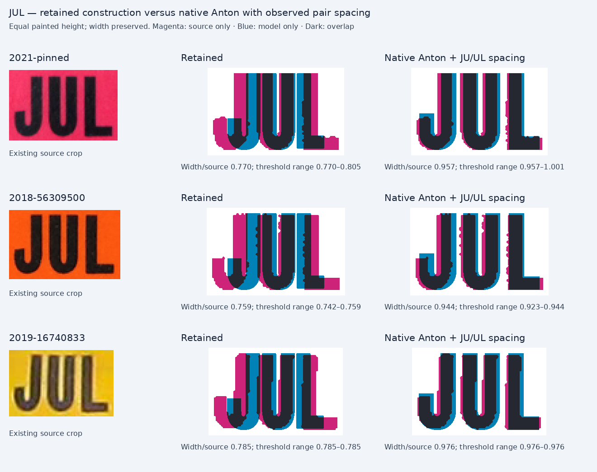

# Bounded modern JUL review

The existing native Anton outlines provide a supported improvement for **2021 JUL only**. Reuse `anton-400`, add `JU: 2.5` and `UL: 3.5` cap-unit pair spacing, and register actual paint height and centre to the pinned source. No contour edits, extra stroke, independent horizontal scale, or historical typeface attribution are proposed.

The exact integration record is [proposal.json](proposal.json). Its run is `x: 0.06772`, `baseline: 0.598`, `cap: 0.44494`, `width: 0.34`, `profile: anton-400`, `tracking: 0`, `anchor: start`, `kerning: {JU: 2.5, UL: 3.5}`. Replace only `decal-month` inside the existing 2021 July variant. The actual scene remains a natural fit. At a 230 × 100 view box its paint bounds are `[16.5366, 15.3060, 86.9332, 60.2045]`; the source, registered by uniform frame height and horizontal centre, occupies `[15.0000, 15.3061, 88.4694, 60.2041]`.

## Evidence and result

| Existing photograph | Retained width/source | Native Anton with pair spacing | Accepted threshold range for candidate |
|---|---:|---:|---:|
| Pinned 2021 JUL, control 36946964 | 0.770 | 0.957 | 0.957–1.001 |
| 2018 JUL, control 56309500 | 0.759 | 0.944 | 0.923–0.944 |
| 2019 JUL, control 16740833 | 0.785 | 0.976 | 0.976–0.976 |

These ratios compare isolated painted runs at equal painted height. They are width diagnostics, not contour accuracy scores. The two additional photographs corroborate J/U shapes and pair gaps; they do not authorize changes to those years. The 2021 comparison uses the pinned PNG derivative, not a fourth independent specimen.



At equal glyph height, native Anton's J and U are approximately 1.01× the 2021 source widths. The retained construction is approximately 0.90× for both. Across the three sources, Anton J is 1.01–1.02× and U is 0.97–1.01×. The source JU gap is about 0.091–0.093 of painted run height; UL is about 0.093–0.114. Candidate gaps are approximately 0.090 and 0.110. Pair adjustments repair spacing independently of the glyph shapes.

The **L foot remains approximately 15–17% too short** at equal glyph height, and the J hook is slightly higher than the photographs. The candidate therefore remains an approximation. Expanding pair gaps enough to erase the remaining run-width difference would create unsupported spacing. The small, blurred, unrectified photographs also do not establish exact historical typeface identity, precise contours, colour, or physical printing characteristics.

## Rejected shortcuts

The review compared the retained weighted construction and 15 native candidates already available in the repository. Native `heavy-month-wide` is about 8% broad as a run and approximately 21% broad in J/U. Oswald 700 appears close in total run width, but its J is about 30% narrow and its U about 22% broad. These opposing glyph errors must not be accepted because a total ratio is near 1.000. See [native-candidates.png](native-candidates.png) and [separate-glyphs.png](separate-glyphs.png).

The retained weighted profile includes its actual 2.5 cap-unit filled stroke in every comparison. Native candidates retain their original outlines, advances and weight. The selected pair adjustment introduces no new glyph paths.

## Audit and reproduction

All three source crops retain clearance at all five thresholds, use two populated intensity classes with at least 25 luminance levels of class-mean separation, and contain three stable tall components. The 15 accepted samples are recorded individually in [metrics.json](metrics.json); clipped or insufficient-contrast samples would be recorded with reasons and excluded from valid ranges. No new source downloads were made.

Source paths, original sizes, hashes, crop rectangles and threshold samples are in the metric ledger. The original source URLs and credits remain in `../../modern/source-inventory.json` and the pinned gallery metadata. Candidate provenance and source-font hashes remain in `../../../decal-glyph-analysis/candidate-provenance.json` and `../../../decal-review/printing-provenance.json`; `heavy-month-wide` is the native supplied Helvetica Compressed candidate, while the retained profile uses a previous width construction. No font software is added.

From the repository root:

```sh
node docs/research/bc-decal-residuals/lettering/modern-jul-review/render.mjs
python3 docs/research/bc-decal-residuals/lettering/modern-jul-review/analyze.py
node docs/research/bc-decal-residuals/lettering/modern-jul-review/build-proposal.mjs
```

The later bounded [canonical JAN check](jan-review/README.md) reuses the same native candidates but retains the existing JAN contours and proposes only observed pair-spacing changes. After both analyses, `python3 docs/research/bc-decal-residuals/lettering/modern-jul-review/render-glyph-comparisons.py` regenerates both independent glyph panels.

The renderer produces 68 isolated runs, all with natural fit. The proposal helper renders the actual current application scene and modifies its typography only in memory. It verifies the exact audit month/control and queries painted bounds with Inkscape. This is scene/SVG validation, not a browser-parity claim. The production implementation is integrated separately by the main task.
