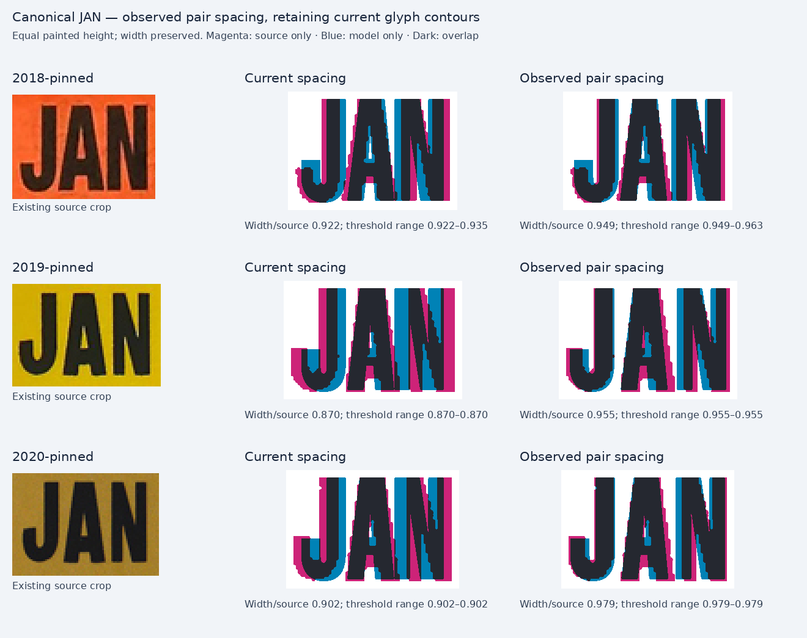

# Bounded canonical JAN review

**Retain the current `heavy-month-weighted` contours. Correct the observed pair gaps in the exact 2018, 2019 and 2020 JAN variants.** Existing native alternatives do not improve the complete J/A/N diagnostics. This is the final bounded follow-up to the JUL review; no additional sources, new outlines or other months are included.

## Why JAN does not use the JUL face

Native Anton is useful for the observed 2021 JUL, but its A counter extends much higher than the small JAN photographs show. Its J also becomes about 12–14% broad for 2018 and 2020, while N is little improved. The outer A width alone is not sufficient reason to replace the face. Native `heavy-month-wide` is much too broad, and the Oswald alternatives trade a narrow J for broader A/N. [native-candidates.png](native-candidates.png) compares the available native runs; [separate-glyphs.png](separate-glyphs.png) makes the Anton counter and J-width problems visible independently of spacing.

## Supported spacing changes

The retained printed gaps are approximately 0.017 and 0.003 of painted run height for JA and AN. The 2018 photograph is tighter than the later two examples, so its JA gap remains unchanged. AN +4 cap units opens its nearly touching printed AN to the observed small gap. The 2019 and 2020 sources have larger visible JA/AN gaps; these are handled independently in their existing exact JAN variants.

| Exact source | Pair adjustments, cap units | Source gaps JA / AN, per run height | Candidate gaps JA / AN | Width/source before → after |
|---|---|---:|---:|---:|
| 2018 JAN, 50278580 | AN +4 | 0.021 / 0.043 | 0.013 / 0.043 | 0.922 → 0.949 |
| 2019 JAN, 10727925 | JA +5, AN +9 | 0.067 / 0.089 | 0.063 / 0.090 | 0.870 → 0.955 |
| 2020 JAN, 00000000 | JA +5, AN +7 | 0.068 / 0.068 | 0.060 / 0.070 | 0.902 → 0.979 |



The small difference in raster-derived JA gaps between isolated runs reflects subpixel placement at the 300-pixel comparison height; no J or A outline changes. The proposals also match actual paint height and centre to each source using uniform scale. Actual pair spacing is recorded in the SVG and the run settings rather than inferred from rounded raster values.

The full exact-month run proposals, source hashes, uniform registration and actual Inkscape paint bounds are in [proposals.json](proposals.json), schema `plateforge.exact-month-spacing-proposals/v1`. Replace only `decal-month` inside the matching JAN variant. All candidate scene renders have natural fit; the original 2.5 cap-unit filled stroke remains present. Other scene roles are not changed by these proposals.

| Exact variant | x | baseline | cap | width guard | Actual paint bounds at 230 × 100 |
|---|---:|---:|---:|---:|---|
| 2018 JAN | 0.09734 | 0.62034 | 0.46865 | 0.32 | [22.6078, 14.5832, 91.7651, 63.5412] |
| 2019 JAN | 0.02383 | 0.58974 | 0.44871 | 0.32 | [5.6914, 13.5421, 76.3933, 60.4170] |
| 2020 JAN | 0.05182 | 0.57964 | 0.43874 | 0.32 | [12.1248, 13.5416, 80.3783, 59.3750] |

All use profile `heavy-month-weighted`, anchor `start`, and tracking 0. The source registration preserves the photograph's aspect; only frame height and horizontal centre are aligned. These values are reconstruction coordinates, not physical metrology.

## Residuals and evidence limits

A remains roughly 10–15% narrow at equal glyph height. N remains roughly 10–13% broad in the 2019/2020 photos. J hook shape and A counter remain approximate. The remaining whole-run shortfall is kept visible; pair gaps are not expanded to hide those contour errors. Native Anton is therefore rejected for these JAN variants despite its closer total width in one photo.

All 15 threshold samples pass contrast, crop-clearance and component-count checks. The 2018 candidate ratio spans 0.949–0.963 over the tested thresholds; the 2019/2020 extents do not change over the tested range. Stable threshold extents do not eliminate photographic blur, perspective or segmentation uncertainty. The 2020 control `00000000` is qualified sample evidence, not proof of ordinary issuance. No historical font identity is claimed.

## Reproduction

```sh
node docs/research/bc-decal-residuals/lettering/modern-jul-review/jan-review/render.mjs
python3 docs/research/bc-decal-residuals/lettering/modern-jul-review/jan-review/analyze.py
node docs/research/bc-decal-residuals/lettering/modern-jul-review/jan-review/build-proposals.mjs
```

There are 76 isolated candidate/glyph renders: the retained face, 15 existing native alternatives and three spacing proposals, each rendered as JAN and J/A/N. All are natural fits. The actual scene helper mutates typography only in memory and validates the exact audit month/control before querying the rendered ink. No browser-parity claim is made.
