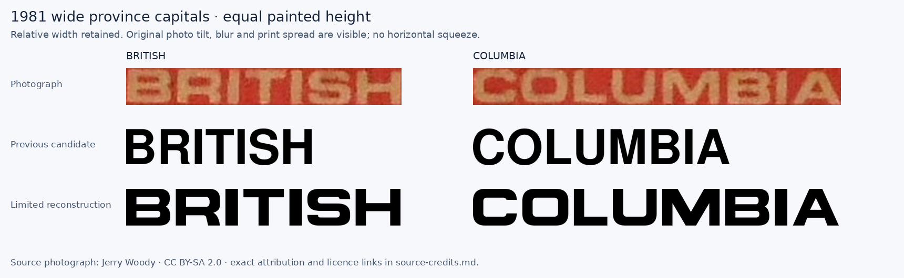
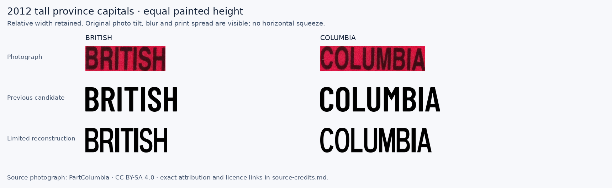

# BC decal province lettering and retained-case placement

This second pass makes bounded corrections to the small province words, annual control panels and observed control positions. **All 28 first-pass retained references have an individual decision.** A corrected secondary role does not mean the complete decal is historically exact or finished.

The final proposal set contains 31 base or exact-month entries. The proof was rendered from the **unmodified integrated checkout**, compared with the complete clean first-pass checkout at `24689246670c25f91e0d1676a0647f053dbca68e`. It covers the 28 retained cases, the related 2011/2013 province cases, and the held 2004 province example. The same explicit month and control inputs are used on both sides.

## Open the evidence

- [Before/source/after proof gallery](proof/index.html): five contact sheets covering every retained case, plus ten detailed whole-group proofs and source/bounds overlays.
- [All 28 decisions, CSV](retained-case-decisions.csv) and [JSON](retained-case-decisions.json): each case retains a concrete uncertainty or remaining mismatch.
- [Mergeable implementation proposals](implementation-proposals.json): complete role/layout values, explicit month scope, source URLs and measurement basis.
- [Actual painted bounds](rendered/paint-bounds.json), [38 source/before/after role measurements](proof/measurement-table.json), and [annual/1980 panel clearances](proof/panel-measurements.json).
- [Source credits](source-credits.md), [original-file manifest](source-manifest.json), and [render/input provenance](rendered/render-inputs.json).

## What changed

### The wide 1981–82 province capitals

The larger [1981 OCT photograph](https://commons.wikimedia.org/wiki/File:British_Columbia_Sticker_Decal_October_1981.jpg) shows broad, rounded-square capitals that the previous Nimbus candidate cannot reproduce at the same height. The [1982 JUL photograph](https://commons.wikimedia.org/wiki/File:British_Columbia_Sticker_Decal_July_1982.jpg) corroborates the family, with greater blur. The replacement independently authors only the 12 capitals used in BRITISH and COLUMBIA; it has no fallback alphabet and does not stretch an existing font.

| 1981 OCT word | Previous width / source at equal paint height | New width / source |
|---|---:|---:|
| BRITISH | 0.673 | 0.997 |
| COLUMBIA | 0.697 | 0.994 |

The larger letters are about 31–32 pixels high. Repeated B and I occurrences constrain width and spacing, but fine corner radii and print spread remain approximate. The tiny pinned JUN/JAN lines provide approximate whole-line placement, rather than individual glyph traces. The family alphabet is shared; observed JUN 1981 and JAN 1982 placement is scoped separately.



### The tall 2010–13 province capitals

The [2012 AUG original](https://commons.wikimedia.org/wiki/File:ICBC_Aug_2012_Registration_Decal.png), photographed by PartColumbia, is 1825×763 pixels. Its individual province capitals are roughly 103–107 pixels high. It supports an independent limited alphabet with rounded C/O bowls, a short curved R leg and the observed narrow B, I and H proportions. The pinned 2010–13 words corroborate the subset; the construction is not applied to the later vertical legends.

| 2012 AUG word | Previous Barlow width / source | New width / source |
|---|---:|---:|
| BRITISH | 1.142 | 1.024 |
| COLUMBIA | 1.141 | 1.061 |

These comparisons preserve the original slight photographic tilt and match full painted height uniformly. The remaining 2.4% and 6.1% breadth is visible. It is not hidden by extra horizontal scaling or by tightening spacing to absorb photographic tilt. Historical typeface identity remains unconfirmed.

The existing MAY 2011 and OCT 2013 month, year, serial and barcode settings are preserved when merging the province-only variants. JAN 2010 and NOV 2012 also receive bounded uniform date-size/placement corrections: raising the barcode to the source first exposed that the old date blocks sat too low. The final month/barcode gaps are 4.082 and 5.000 SVG units in a height-100 frame, respectively. Their native date outlines are unchanged; NOV 2012 remains about 8% narrow at equal height, and the other date-width residuals remain in the ledger.



### Other province candidates and controls

The larger 1985 FEB, 1987 FEB and 2006 APR sources support heavier province lettering than the former candidate. Native Archivo 900 at its width-75 design axis supplies that weight without a horizontal squeeze. This is a visual candidate, not an attribution of a historical font.

The 2006 tiny MAY masks remain rejected. Its nominal province size is instead supported by the larger APR province/year height proportion. The stack moves 2.5 SVG units right as an explicit **family clearance constraint**: this accommodates wide MAR and MAY runs while preserving cap height, outlines and spacing. It is not claimed as an exact translation measured from the rejected MAY mask. The integrated COLUMBIA/right-year bounding-box gap is about 1.091 units; the central all-month check verifies the individual painted shapes.

The annual 1971, 1974, 1975 and 1976 controls were oversized. Their native digits are uniformly reduced, spacing is adjusted to the observed runs, and the panels are measured independently. The 1975 province correction also required reducing and moving the existing 75 uniformly; the final COLUMBIA/year gap is 2.666 SVG units. No new year contour is introduced. The 1980 control mask touches the frame and is rejected: only the independently inspected panel moves, while the control inherits its first-pass run.

The largest old-control registration corrections are scoped to their exact photographed months:

| Specimen | Horizontal movement | Vertical movement of painted bottom |
|---|---:|---:|
| JAN 1990, control 30863010 | 3.01 units left | 17.94 units down |
| JUN 1991, control 55232623 | 9.68 units right | 7.27 units down |
| OCT 1992, control 59693121 | 8.47 units left | 7.26 units down |

An independent JAN 1990 specimen also places its control low. The independent JAN 1991 specimen places its control much higher than the pinned JUN specimen, so a year-wide registration rule would be unsupported. Additional exact-month translations cover APR 1989, OCT 1993, NOV 1995 and MAR 1996. The 1996 pink variant remains a separate retained case.

## What remains unresolved

The seven retained cases with no new typography/registration correction are 1978, 1994, 1996-pink, 1997, 1998, 2005 and 2007. They are still individually reviewed. Some control movements fall within approximately one or two source pixels; some province masks touch adjacent paint or are too small to establish new contours. Physical corner changes made by the central pass are separate from this typography decision.

The 2004 province letters remain approximate. The pinned letters are only about 5–6 pixels high, and their segmentation touches inspection boundaries. They do not support an exact alphabet or a reliable fine adjustment. The 2004 year is corrected in the separate lettering work; this package deliberately retains the tiny province candidate and shows that limit in the proof.

Small province shapes remain provisional in the annual, 1988, bordered 1989–98 and 2005/2007/2009 families. The 1980 and 1987 control shapes/widths still differ. Main month/year proportions remain first-pass candidates where this pass changed only secondary printing or registration. Colour, material finish, cut tolerances and historical typeface identity are not established by these photographs.

## How the comparisons are kept honest

1. Each pinned source keeps its exact month, control, dimensions and crop hash. A clearer corroborating photograph is never silently substituted for the pinned specimen.
2. Source, before and after frames align by uniform height and horizontal centre. Shape strips also match painted height uniformly, preserving relative width.
3. Each segmentation threshold has an explicit accepted/rejected result. Empty, low-contrast or boundary-touching masks are excluded from accepted extent ranges and production targets. Target builders raise if a rejected mask is requested. The retained rejected rows remain inspectable.
4. Tiny lines provide approximate whole-line extent only. Their subpixel edges are not treated as reliable glyph contours or scored as such.
5. Candidate analysis data exactly match both production profile paths and advances, as recorded in [profile-equivalence.json](profile-equivalence.json). Final placements are checked through the actual renderer and Inkscape, including overshoots and native side bearings.
6. The complete integrated family tests and application/export gates belong to the central pass. This evidence package does not claim an interactive browser check.

## Reproduce this package

Run from the repository root with the clean first-pass checkout beside it at `../plateforge-decal-pass1`. The source fetcher is optional because the credited originals are already preserved; it caches verified bytes and stops on HTTP 429 rather than automatically retrying a rate limit.

```sh
python docs/research/bc-decal-residuals/province-placement/measure-primary-roles.py
python docs/research/bc-decal-residuals/province-placement/compare-province-candidates.py
python docs/research/bc-decal-residuals/province-placement/build-retained-ledger.py
node docs/research/bc-decal-residuals/province-placement/render-proposals.mjs --integrated --all-reviewed
python docs/research/bc-decal-residuals/province-placement/measure-rendered.py
python docs/research/bc-decal-residuals/province-placement/build-proof.py
python docs/research/bc-decal-residuals/province-placement/build-panel-proof.py
python docs/research/bc-decal-residuals/province-placement/build-shape-proofs.py
```

To recreate proposals before integration, run `create-proposals.py`, then `append-province-proposals.py`, render without `--integrated`, run `measure-rendered.py --calibrate`, and render/measure once more. That process mutates only isolated in-memory role records and the proposal artifact. Central integration is a separate merge that preserves unrelated month roles and layout fields.
