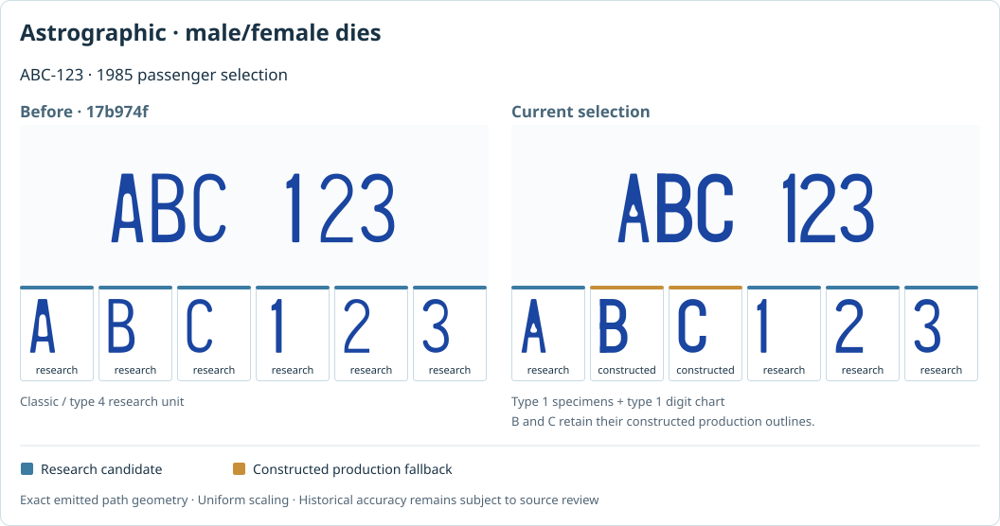

# B.C. font continuation: selection, evidence and reproducible review

Reviewed **2 November 2026**, starting from main **`17b974f51c687780c5d0b106fd9ae37e4c83ccae`**.

This pass fixes the selected passenger alphabet, audits actual rendered characters
across the B.C. catalogue, and adds primary references for the next contour study.
It preserves the committed glyph geometry and research registry. The original
photographs, manufacturing tooling and complete archived tracing pipeline are
different kinds of evidence and remain separately identified.

## Review the results



- [Interactive, self-contained font evidence report](../../../public/bc-font-audit/index.html): focused serial strips, character-level provenance, filters over the full sampled inventory, and links to the newly reviewed sources. Save the HTML locally to use its visuals and controls offline.
- [Before/after comparison](../../../public/bc-font-audit/before-after.html): the four affected 1985 passenger choices, with frozen original and corrected serial strips.
- [Research findings](RESEARCH.md): official specifications, the 2025 U/Y/Z photographs, candidate fonts and remaining evidence needs.
- [Source ledger](sources.json): 13 sources, inspection notes, original URLs, hashes and individual occurrences in the three new photographs.
- [Complete occurrence audit](audit.json), [before/after receipt](before-after.json), and [validation receipt](validation.json): machine-readable checks and their limits.

The application links to the evidence report from **Typography identity** on B.C.
plates. A repository branch can be reviewed without changing the deployed site;
the public application route becomes available when that branch is published.

## What was wrong, and what changed

### Selected Astrographic types could draw another type

In the original registry, the first candidate for **Astrographic types 1, 2 and 3**
on `1985-flag` was the Classic/type-4 unit. Selecting a different named die did
not reliably select its corresponding researched alphabet.

`src/templates/dies/research-policy.ts` now defines small, explicit passenger
candidate pools. A type can use only its own labelled, already-bound serial
units. Original ranking is retained within each pool. Missing characters fall
back to that selected production profile, with the existing SVG provenance tags.
The policy constrains source selection; it does not authenticate the source's
historical attribution or certify a complete alphabet.

### Editing a serial could change an existing character

The whole-run preference could choose different research units for `0`, `06`
and `A0`, changing both the zero's outline and its advance. Protected passenger
alphabets are now stable across measurement, editing and splitting around the
flag. Fixed-word and other unrelated research selection behavior is retained.

An explicit pool with no admissible units also returns the original production
profile, so a previously merged profile cannot carry another context's research
through that fallback path.

### The historical Waldale choice used the modern source

The 1985 passenger option labelled **Waldale test run, 1998–99** inherited the
modern `2001-flag` passenger master. It now uses the separately labelled trial-run
unit. Unobserved `R` and `L`, for example, remain constructed rather than acquiring
another class's source glyphs.

The exception is resolved from the **active format**, rather than the age of an
inherited recipe. This matters because commercial, farm, trailer and sample
recipes reuse the flag recipe. The first implementation exposed an inheritance
regression in the full before/after audit; it was corrected before publication.
Ten explicit inheritance regressions protect those shared recipes.

### Existing modern choices were checked carefully

The previous Waldale `0/1/7/A/J/P` changes are already implemented in production.
The old September isolated-study README now links to this continuation rather
than leaving its historical “no production patch” statement without context.

**U/Y/Z were already disclosed constructed fallbacks in actual modern passenger
rendering.** Broad raw registry bindings are not sufficient to establish which
glyph the application draws: the live recipe's context also matters. New tests
protect that existing behavior; this pass does not claim to have newly recovered
or traced those three letters.

## Audit scope and results

The current checkout contains **447 B.C. formats**. Older reports' 446/448 totals
describe earlier scopes and are not reused as the current count.

| Audited sample group | Cases |
| --- | ---: |
| One deterministic default per B.C. format | 447 |
| Every explicitly offered die selection, including default choices | 193 |
| Focused passenger and small-format examples | 13 |
| Total | 653 |

Across the **640 default and explicit-choice cases**, the audit records:

| Emitted nonspace die-glyph classification | Occurrences |
| --- | ---: |
| Research candidate | 10,354 |
| Production profile override | 1,315 |
| Constructed production glyph | 1,291 |
| Total | 12,960 |

Repeated characters and overlapping default/explicit-choice samples are counted
individually. These are renderer occurrence counts, not unique historically
verified characters or an accuracy percentage. The focused examples are excluded
from that occurrence denominator. Another **125 tagged fixed-artwork characters**
are retained separately; live typeface text is also recorded outside the die
counts.

All sampled serials pass their format validators. Selected dies govern their
observable serial runs, provenance tags are coherent, and each research path
matches the exact unit/index in the committed registry. There are **zero
structural errors, selected-die mismatches or invalid sample cases**.

The frozen comparison identifies exactly **four changed 1985 explicit choices**:
Astrographic 1, 2, 3 and the Waldale trial. The same changes appear in their four
focused duplicates. All **447 default samples** retain their original **glyph
outline/provenance signatures**. This comparison does not measure photographic
accuracy, pixel parity, embossing, color or complete scene placement.

## New research that matters

The [research note](RESEARCH.md) distinguishes the following evidence:

1. **ICBC's 2013 procurement Q&A explicitly distinguishes three font categories:** large plates, motorcycles, and other small plates. Its dated dimensional specifications provide useful checks, but not a downloadable serial font.
2. **A BC government release confirms larger motorcycle characters from May 2011.** Its relative increase and the RFQ's generic small-plate height are recorded independently; the review does not derive an unsupported absolute motorcycle height.
3. **ICBC's June 2025 bulletin confirms the new passenger pattern and U/Y/Z repertoire, while excluding I/O/Q.** Actual source-owner photographs of A907GU, A820EY and A250EZ add 18 observed occurrences across 12 distinct characters. Their resolution and obstructed corners prevent precise contour fitting in this pass.
4. **An independently authored BC raster alphabet is available in Googlefluff's BeamNG pack.** It is a useful comparator with creator credit permission; its all-letter grammar and raster material maps are not official plate specifications. Driver Gothic and Dealerplate do not provide an identified exact BC replacement.

## Remaining evidence gaps

The audit makes unresolved source mixing visible. In its focused examples,
`motorcycle-2011` draws candidates from ordinary, 2011 and collector motorcycle
cohorts. `trailer-utility-2016` draws some candidates from farm-tractor and
trailer-floater units. Successful rendering does not establish that those classes
shared tools. Their source constraints need a separate review, especially in
light of the official three-category evidence.

The generated registry retains role, title, review readiness and glyph indices,
but does not contain every source URL, physical class, date or rectification
measurement. Its original catalogue and format-role inventory were archived
outside this repository. Reconstructing the entire research pipeline therefore
still requires those inputs; the new audit itself is reproducible from the
checkout. The passenger policy is kept outside generated data so a later archive
rebuild cannot silently undo it.

The next contour pass should prioritize well-resolved, straight-on U/Y/Z examples
and separate motorcycle/other-small cohorts. Record physical corners, image
scale, source dates and every repeated occurrence before comparing native widths,
counters, terminals and paint spread. Agreement between two reconstructions is
not independent evidence of the original tooling.

## Reproduce and verify

From the repository root:

```sh
npm ci
npm test -- --maxWorkers=2
node scripts/audit-bc-font-evidence.mjs --check
node scripts/compare-bc-font-evidence.mjs --check
BASE_PATH=/plateforge/ npm run build
node scripts/typography-verify.mjs
```

Omit `--check` from the audit or comparison command to regenerate its outputs.
The comparison uses the compact, frozen [baseline snapshot](baseline-17b974f.json)
captured from the original checkout. Its check rejects unexpected changed cases,
changed default glyph signatures, and added/removed samples. Future intentional
changes must review and update that scope explicitly.

The audit uses the real `bcTemplate` via Vite server rendering and Python's
standard XML parser. Its source content hashes, not a changing Git commit ID,
timestamp or absolute path, make the generated output reproducible in CI.

For browser checks, install the existing pinned test dependencies separately:

```sh
npm install --prefix /tmp/plateforge-browser --ignore-scripts --no-audit --save-exact playwright@1.56.1 pngjs@7.0.0 pixelmatch@7.1.0
node /tmp/plateforge-browser/node_modules/playwright/cli.js install --with-deps chromium firefox webkit
TYPOGRAPHY_BROWSER_DEPS=/tmp/plateforge-browser/package.json TYPOGRAPHY_BROWSER=chromium node scripts/bc-font-audit-smoke.mjs
```

Repeat the last command with `firefox` and `webkit`. The dedicated checks cover
selected families in the production UI, unchanged constructed U/Y/Z disclosure,
SVG outline/provenance preservation, visible PNG/Tesla output, the research
toggle, phone layout, report filters and offline use. Existing typography tests
continue to cover broader raster/font parity.

The new regression tests were also run against original source: **six intended
regressions fail, while twenty control tests pass**. Full current validation and
browser results are recorded in [validation.json](validation.json). The
`Typography validation` workflow reproduces both audits and runs the new browser
checks in all three engines.
