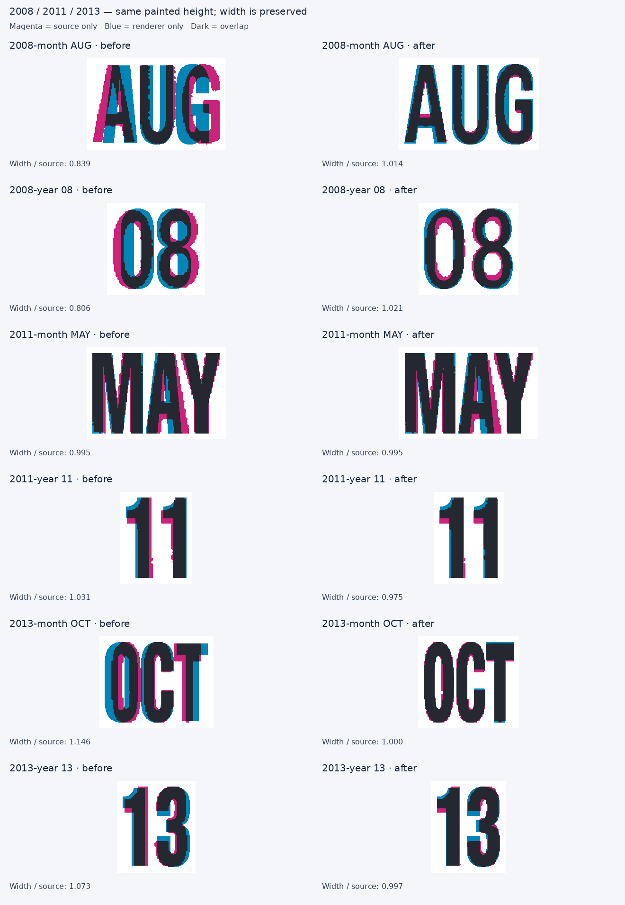
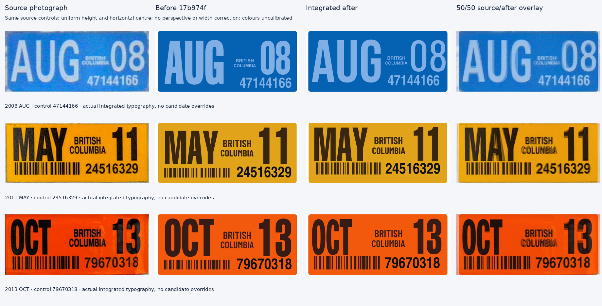

# B.C. 2008, 2011 and 2013 printing follow-up

These are bounded corrections to the remaining strong cases from the all-family overlay review. The shared typography owner integrates the per-role proposals and checks the complete decal and other selections. Original profiles remain available as before evidence.

## 2008: lighter printed forms

The [2008 AUG photograph](https://www.bcpl8s.ca/images/Decals/Passenger/2008.jpg) shows considerably lighter printing than the previous heavy month/year profiles. The source has an open A aperture, rounded U, a G without a projecting lower spur, a more open 0, and two distinct counters in 8.

The exact AUG selection uses unchanged native **Bebas Neue Regular** outlines from the already archived font comparison. The fixed year `08` uses unchanged native **Oswald at weight 400** outlines. Neither profile receives x-only scaling, a synthetic outline stroke or width-fitted tracking. Both are visual candidates, not historical font identifications.

The AUG candidate still has an imperfect A aperture/bar and G terminal. The source 0 is more continuously oval than Oswald's outer bowl. These differences remain visible and should not be erased by photographic noise tracing. Other month letters in the native font are unverified coverage; only AUG is proposed for this month assignment.

The source year ROI starts at x174. An earlier exploratory crop started at x170 and included a small fragment of the adjacent COLUMBIA line. That contamination made wider year candidates appear closer than they were. The final mask has exactly two large components and a paint box `[175,15,231,67]` in the 238×100 source. The contaminated measurement is excluded from the saved final metrics.

## 2011: preserve MAY, restore its position

The [2011 MAY source](https://www.bcpl8s.ca/images/Decals/Passenger/2011.jpg) already agrees closely with the stored month construction at equal height. Its width ratio is 0.995, so replacing it with a different font would not address the clearest error. The source MAY paint box is `[14,8,103,64]` in 239×100 pixels, compared with the previous model's `[11.531,13.386,99.600,69]` on its 230×100 canvas. The principal error is approximately five percent of the decal height downward.

The proposal retains `heavy-month` and sets the requested cap/width so the actual MAY run has a 56-unit painted height without another uniform width reduction. This retained profile contains the earlier supplied-font width reconstruction; this change does not introduce a new x transform or claim that the retained profile is a native unmodified font.

The year `11` similarly retains its existing glyphs. Its two source starts are 24 pixels apart at a 56-pixel painted height. Pair adjustment `11:-4` cap units gives essentially that pitch at the proposed cap height. The resulting complete run is 2.5% narrower than the source, because its existing individual 1 outlines are slightly narrower. The pair adjustment is justified by the repeated starts; it is not adjusted further to compensate for that contour difference.

The province, barcode and control line also sit too low in the former model. Their safe, separately cropped source paint boxes are in `source-role-boxes.json`. No new province or control alphabet is asserted from the small source lettering.

The supplementary province/control translations and barcode box are scoped to the photographed MAY selection. Other 2011 months retain their previous layout, so an unobserved taller month cannot acquire a barcode that rises into it. The same restriction applies to the supplementary OCT 2013 layout below.

## 2013: exact OCT and the 13 pair

The [2013 OCT source](https://www.bcpl8s.ca/images/Decals/Passenger/2013.jpg) has clean 58–59-pixel-high O/C/T forms. The previous stored month outlines are about 14.6% broader at equal height. Native candidates examined did not improve both the narrow width and the heavy printed weight.

`late-oct-reconstruction` therefore supplies only O, C and T as clean independent vectors. The source supports a narrower outer O, its approximately ten-cap-unit counter, the C opening and straight terminal cuts, and the narrow T stem. Their authored painted widths are 37.5, 35.5 and 34.5 units; advances 40.5, 37 and 37 preserve the observed starts. Only exact OCT on the 2013 entry uses this profile. Other months retain their previous profiles. The final equal-height width ratio is approximately 1.000; this numerical result does not establish fine contour accuracy beyond the small source.

The year `13` keeps the existing numeral contours and uses pair adjustment `13:-6`. The previous native placement left too much space after 1. The narrower pair improves the complete width ratio from 1.073 to 0.997 while leaving the individual paths unchanged. Its 3 bowl and terminals remain approximate.

The second province-line crop starts at y39 and contains ink from y40 onward. Starting at y37 would include the bottom of BRITISH and overestimate the COLUMBIA height. Final source boxes explicitly exclude that adjacent ink.

## Shape evidence

| Run | Before width / source | After width / source | Main correction |
|---|---:|---:|---|
| 2008 AUG | 0.839 | 1.014 | Native lighter print, more open counters |
| 2008 08 | 0.806 | 1.021 | Native lighter 0/8 candidate |
| 2011 MAY | 0.995 | 0.995 | Placement and actual fitted height; contours retained |
| 2011 11 | 1.031 | 0.975 | Retained glyphs, supported pair pitch |
| 2013 OCT | 1.146 | 1.000 | Exact-month O/C/T construction |
| 2013 13 | 1.073 | 0.997 | Retained glyphs, supported pair pitch |



Every comparison matches painted height and centre uniformly; width is preserved. Magenta denotes source only, blue renderer only, and dark overlap. Before/after source crops, masks and SVG/PNG runs are retained under `evidence` and `rendered`. `metrics.json` records every source glyph box, the checked ROI, hashes, raster bounds and ratios. The original photographs remain unrectified, and colours are not calibrated.

`role-proposal.json` contains concrete x/baseline/cap/width/profile/spacing changes for integration. It aligns each source to the 230×100 model using uniform photo-height scaling and horizontal centre alignment, then matches the chosen painted anchor and height. The proposed budget leaves a little room beyond the natural advance width. A native end anchor can exceed 1.0 slightly because of blank sidebearing; actual painted bounds, rather than the anchor alone, determine clearance. The 2008 year proposal's paint still ends three model units inside the canvas.

These proposals do not rectify physical decal corners or certify the crop aspect ratio. Final complete-decal inspection may require conservative adjustments where scan shape and uncertain physical dimensions disagree.

## Final integrated verification

The final capture uses the actual integrated `decalArt` and `buildDecal` path, with `candidateTypography:false` and no in-memory layout overrides. The controls are exactly the photographed 47144166, 24516329 and 79670318. The before SVGs are frozen from baseline `17b974f51c687780c5d0b106fd9ae37e4c83ccae`; their hashes and the revised SVG hashes are in `integrated/manifest.json`.



The actual two-digit barcode branch initially ignored the source-backed layout settings even though the JSON and month selection were correct. Integrated raster inspection exposed that difference; the renderer now reads the audited barcode box and retains its default for other selections. The verified 2011 painted barcode box is approximately `[12.509,66,119.510,86]` on the 230×100 canvas, against source-derived `[12.5,66,119.5,86]`. The 2013 box is `[8.991,69,117.993,91]`, against `[9,69,118,91]`. These extents describe placement, not a claim that every photographed barcode edge or print defect was recovered.

The 2008 AUG province and control receive only source-backed translations. Their uncertain small lettering and native glyph shapes stay unchanged. The control now paints at approximately `[131.421,72.739,216.563,90]`, close to source-derived `[132,72,216,90]`. The province remains visibly narrower than the low-resolution source.

Every text and barcode paint box in all three revised captures is inside the canvas. `integrated/paint-bounds.json` retains before/after role bounds and exact serials. Remaining differences include the 2008 A aperture, G terminal, 0 curve and small province width; the 2011/2013 province proportions and some control contours; and the small-source uncertainty in OCT and the 13 bowl. No further shapes were changed merely to improve a width ratio.

## Reproduce

```sh
python scripts/build-bc-late-printing.py
node scripts/render-bc-late-two-digit.mjs
python scripts/analyze-bc-late-two-digit.py
node scripts/render-bc-late-integrated.mjs
python scripts/analyze-bc-late-integrated.py
```

The native font source software is not added. The new JSON copies outlines already archived in the repository; native widths and advances remain unchanged. Font source URLs, source-font hashes, weight and outline-file hashes are in `provenance.json`. The OCT reconstruction is readable in `src/templates/dies/decal-late-printing.ts` and is labelled as reconstructed rather than extracted from a font.
