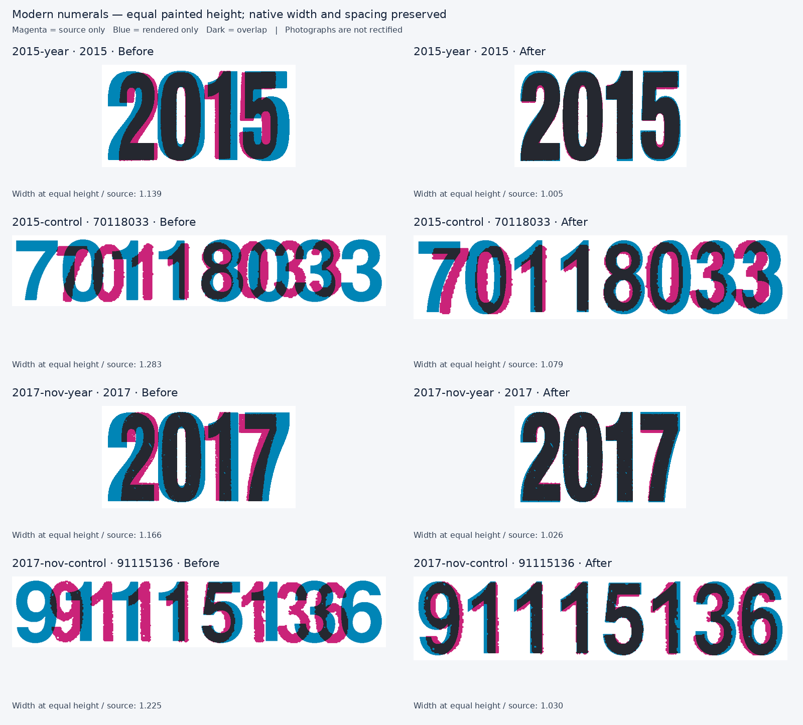

# B.C. modern decal numeral corrections

This change separates the 2014–2023 expiry numerals from the small control numerals. It also supplies an exact-MAY candidate for the 1998 Type II and thick-border 1999 decals. The month lettering used on modern decals and the July 2017 selection boundary remain independent.

## What changed

`modern-year-reconstruction` is an independent vector construction in a 100-unit painted-height system. The earlier Anton candidate was too broad at equal printed height. The new `0` has a narrower outer bowl with a continuous curved counter, `1` has the photographed broad shoulder and narrower stem, `2` has the narrower descending curve and heavier lower join, and `5`/`7` follow their enlarged source examples. Glyph advances are designed separately from the curves, including the additional right-side space following `1`.

`modern-control-reconstruction` retains the native Nimbus Sans Narrow Bold outlines and tabular advances for nine numerals. Only `1` has a new contour: its flag climbs diagonally into the stem, as seen in six photographed occurrences, rather than ending in the previous horizontal shelf. There is no synthetic stroke, independent x scaling, or negative tracking used to force a run-width match. Control digits `2` and `4` remain native comparison candidates that were not observed in the two enlarged control lines used here.

The two roles deliberately use different constructions and weights. Reusing the large expiry forms for the controls would not reproduce the smaller, more open printed numerals.

## Evidence and measured improvement

The source photographs are the credited BCpl8s enlarged [2015 JAN specimen, control 70118033](https://www.bcpl8s.ca/images/Decals/Passenger/2015-70118033(XL).jpg) and [2017 NOV specimen, control 91115136](https://www.bcpl8s.ca/images/Decals/Passenger/2017-91115136(XL).jpg). The exact local source hashes, crop boxes, source dimensions, threshold and every occurrence are in `metrics.json` and `provenance.json`.

The following is a shape diagnostic, not an authenticity or overall quality score. Both masks are uniformly normalized to the same painted height and centre; their relative widths remain visible.

| Observed run | Previous width / source at equal height | Revised width / source at equal height |
|---|---:|---:|
| 2015 year `2015` | 1.139 | 1.005 |
| November 2017 year `2017` | 1.166 | 1.026 |
| 2015 control `70118033` | 1.283 | 1.079 |
| November 2017 control `91115136` | 1.225 | 1.030 |



The remaining control-run difference should not be removed by squeezing the outlines. The 2015 control line slopes by roughly five pixels across the photograph: its complete painted height is 65 pixels, but its individual glyphs are about 58–60 pixels tall. Equalizing the complete run therefore makes the source appear narrower than equalizing each individual glyph. The digit pitch agrees much more closely with the native 63.51-cap-unit advances when the individual glyph heights are considered. November 2017 has much less line slope.

The occurrence comparisons support the change independently of the run totals:

| Feature | Photographed value | Previous candidate | Revised candidate |
|---|---:|---:|---:|
| 2015 control `0`, width / own height, both occurrences | 0.550 | 0.655 | 0.555 |
| 2015 control `0`, midline counter width / height, both occurrences | 0.200 | 0.282 | 0.227 |
| 2015 control `1`, width / own height, both occurrences | 0.390 | 0.436 | 0.386 |
| November 2017 control `1`, four individual widths / own height | 0.373–0.403 | 0.436 | 0.386 |
| 2015 year `2`, width / own height | 0.443 | 0.527 | 0.441 |
| November 2017 year `2`, width / own height | 0.429 | 0.527 | 0.441 |
| Year `1`, two photographs, width / own height | 0.300–0.303 | 0.336 | 0.300 |

For the year `0`, the old and new counter widths are both close to one tenth of the painted height. The substantial correction is the narrower outer bowl, its lower stem-to-counter ratio, and the curve construction around the counter; it is not a claim that the earlier counter was uniformly too wide. The photographs support some variation in outer width, 0.437–0.454 of each glyph's height.

Occurrence images are under `evidence/2015-year`, `evidence/2015-control`, `evidence/2017-nov-year` and `evidence/2017-nov-control`. Each retains the photograph crop, threshold mask, before/after run overlays, and independently normalized character overlays. Magenta is source only, blue is renderer only, and dark is overlap.

## Confidence and remaining limitations

| Role and glyphs | Evidence status |
|---|---|
| Year `0`, `1`, `2` | Reconstructed from two enlarged photographs; original glyph heights about 194–213 pixels |
| Year `5` and `7` | Reconstructed from one enlarged photograph each |
| Year `3`, `4`, `6`, `8`, `9` | Lower-confidence clean constructions checked against small catalogue photographs; they are not exact traces or established historical font forms |
| Year `9` | Uses the related `6` bowl construction as a consistency assumption, checked against the small 2019 specimen |
| Control `0`, `3`, `5`, `6`, `7`, `8`, `9` | Native Nimbus Sans Narrow Bold candidates compared with photographed occurrences |
| Control `1` | Reconstructed diagonal flag, supported by six occurrences across two photographs |
| Control `2` and `4` | Native carryovers; not observed in the enlarged control lines used for this correction |

The source photos are unrectified and differ in crop, scan aspect, print spread, wear and lighting. The analysis preserves those limitations. Repeated occurrences are kept separate; they are not averaged into a claim that every printed digit was identical. Colour is not calibrated. Small-crop threshold changes can affect the low-resolution counters and terminals.

The native alternatives examined included the supplied Helvetica Compressed outline candidate, Anton, Bebas Neue, Oswald, Archivo Narrow, Roboto Condensed, variable-width Archivo, native Nimbus Sans Narrow, and the bundled Antonio variable font. Narrower totals alone did not determine selection: several candidates had an incompatible `1` foot or shoulder, a capsule `0`, a diagonal-top `3`, or a substantially lighter print weight. No historical font or manufacturer identity is claimed.

The model still needs ordinary whole-decal placement checks. `role-proposal.json` changes only the two profile assignments and leaves the shared typography owner to calibrate baseline, cap height, available width and anchor from actual painted bounds. It includes source-height hints, not independent x scaling. The exact-MAY change and its remaining 1999 discrepancy are documented separately in `bordered-may.md`.

## Reproduction and validation

From the repository root:

```sh
python scripts/build-bc-modern-numerals.py
node scripts/render-bc-modern-numerals.mjs
python scripts/analyze-bc-modern-numerals.py
python scripts/analyze-bc-bordered-may.py
```

The renderer uses the actual `dieProfile` registry and `buildDieText` engine. Each diagnostic run uses its natural advances, no maximum-width fitting, and uniform scaling. Inkscape rasterizes the resulting portable SVG; NumPy, SciPy and Pillow prepare the analysis masks and sheets. The source files are existing repository photographs, so no additional source download is needed.

`decal-modern-printing.test.ts` checks leading-zero and all-digit rendering, numeric coverage without font fallbacks, preservation of native control outlines and tabular advances, and the MAY-only profile's pair-spacing behaviour. Root integration checks cover selected profiles, all expiry months, canvas bounds and the full production build. Visual improvement is established by the stored overlays, not by test success alone.
