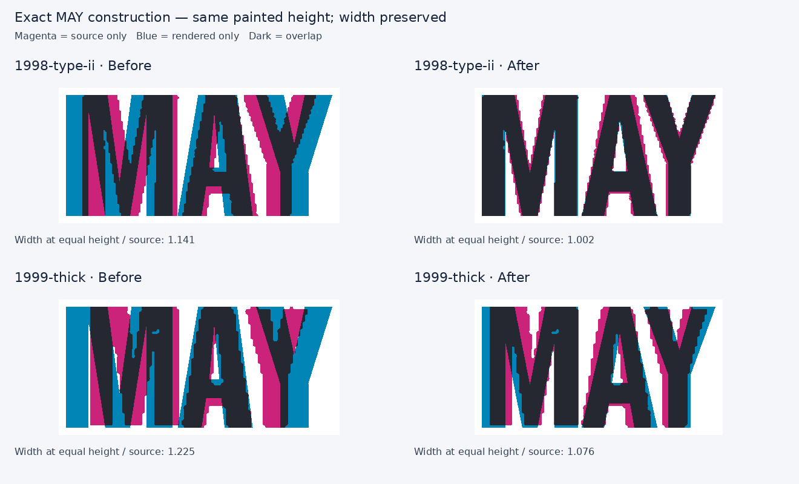

# Exact MAY on 1998 Type II and thick-border 1999

The existing `heavy-month-wide` run was being reduced uniformly to fit its allotted width. That reduced its actual painted height as well as its width. Raising the requested cap height could not restore the height once the same width limit was reached.

The `bordered-may-reconstruction` profile contains only the observed letters `M`, `A` and `Y`. It is selected only for MAY on these two catalogue entries; other months retain their existing candidates. The M's diagonal joins, A's triangular aperture and Y's branch join are independently constructed at native widths. There is no x-scaled font outline. The profile should not be used as an unobserved complete alphabet.

## Width and pair spacing

The 1998 source mask contains a 69-pixel-high MAY run. The original character boxes, expressed in cap-height units, are:

| Letter | Painted width | Start relative to M |
|---|---:|---:|
| M | 79.71 | 0.00 |
| A | 62.32 | 82.61 |
| Y | 59.42 | 133.33 |

The revised forms have painted widths 79.5, 62.5 and 59.5 units. Their authored advances are 82.5, 65 and 62. Pair adjustment `AY: -14` places Y at 133.5 units. The A/Y boxes overlap because the A becomes narrower toward its top while the Y's upper branches overhang. Their painted strokes remain separate. This is a supported pair-spacing correction, not a reduction of the complete word's width or height.

At equal painted height, the old native run was 14.1% wider than the 1998 source. The new construction is 0.2% wider. The photographed paint box is `[21, 19, 154, 88]` pixels in a 373×114 image. This corresponds to x 0.0563, top 0.1667, right 0.4129, baseline 0.7719 and painted height 0.6053 of the image.

## Separate 1999 check

The correct source is the [thick-border MAY specimen, control 54174570](https://www.bcpl8s.ca/images/Decals/Passenger/1999-thick.jpg). The previously mismatched NOV double-outline source is not used. The existing stored photo `public/data/decal-review/sources/1999.webp` is 242×73 pixels. Its MAY paint box is `[11, 12, 99, 61]`, giving x 0.04545, top 0.16438, right 0.40909, baseline 0.83562 and painted height 0.67123.

The shared reconstructed MAY improves this source's equal-height width ratio from 1.225 to 1.076. A real residual remains: its observed individual widths are approximately 0.750, 0.571 and 0.510 of their own heights, with less A/Y box overlap than the 1998 source. The original letter height is only 48–49 pixels. The shared profile is therefore a closer candidate, not proof that both issues used identical forms. Retain this discrepancy until a stronger independent 1999 source supports a separate master. Do not remove it through x-only scaling or force a shorter cap height just to obtain a matching width.

The masks, character boxes, exact source-file hashes and run ratios are in `bordered-may-metrics.json`. Crops and overlays are retained under `evidence/1998-type-ii` and `evidence/1999-thick`. The photographs are unrectified, and no exact physical aspect ratio or historical font identity is inferred from these small scans.
